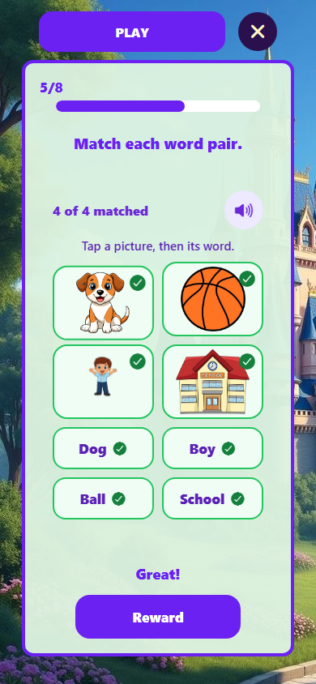

# Lesson media completion

Completed locally on 21 October 2026.

The noun matching activity and related vocabulary activities now resolve concrete concept art instead of reusing the Word Kingdom castle. The shared catalog covers 20 concepts, including naming words, actions, descriptions, and emotions, and is used by both the centralized resolver and existing semantic picture cards across grades.

- Added `PictureWordMatchingBoard`: larger picture cards, two-column word targets, tap or drag matching, keyboard access, spoken instructions, progress counts, and green completion checks.
- Preserved scoring, retries, rewards, and meaningful-completion gating. Fixed browser-native image dragging and retained gesture state through selection rerenders.
- Reworked the ambiguous Similar Words picture activity into distinct synonym pairs. Corrected the reading sentence picture and question to match the intended answer.
- Approved scoped uploads still override shared art, and both shared image components refresh after asset-registry changes. Rejected and pending remote assets do not override usable images.
- Added four original, synthesized PCM sounds for taps, correct answers, retries, and completion. Sound and narration respect the learner sound setting. Bundled sounds now have a source on their first play.

## Preview

## Generated illustrations

Generated with the built-in imagegen tool, with transparent backgrounds. Original outputs were copied into the project; existing source artwork was preserved.

- [writing-child.png](../assets/images/lesson-concepts/writing-child.png)
- [reading-child.png](../assets/images/lesson-concepts/reading-child.png)
- [walking-child.png](../assets/images/lesson-concepts/walking-child.png)
- [happy-child.png](../assets/images/lesson-concepts/happy-child.png)
- [sad-child.png](../assets/images/lesson-concepts/sad-child.png)

The exact prompt for each file is the common opening below, followed by its subject sentence and the common ending.

Opening: Create one isolated educational picture-card illustration for the BatiBot early-learning mobile app.

- **writing-child:** A seated child clearly WRITING with a pencil on paper at a small desk; pencil tip touches the paper.
- **reading-child:** A seated child clearly READING an open book held with both hands, looking down at the pages.
- **walking-child:** A child clearly WALKING slowly, upright relaxed posture, small step, one foot flat on ground, relaxed arms. No running pose or speed lines.
- **happy-child:** Waist-up portrait of a very HAPPY smiling child, broad joyful smile, rosy cheeks, hands near chest. Emotion clearly readable.
- **sad-child:** Waist-up portrait of a SAD child, downturned mouth, raised inner eyebrows, one small tear. Gentle sadness suitable for early learners.

Ending: Friendly polished children's storybook cartoon, warm medium skin, brown hair, purple or teal clothing, softly shaded colors, clear bold silhouette, large readable subject centered with 10% safe padding, square composition. Transparent background, no words, letters, captions, borders, scenery, watermark, or extra people. Output is a production image asset.

## Generated sound files

- [tap.wav](../assets/audio/feedback/tap.wav), 0.15 seconds
- [correct.wav](../assets/audio/feedback/correct.wav), 0.54 seconds
- [retry.wav](../assets/audio/feedback/retry.wav), 0.45 seconds
- [complete.wav](../assets/audio/feedback/complete.wav), 0.96 seconds

These are original synthesized tones, generated locally by [generate-lesson-sounds.cjs](../scripts/generate-lesson-sounds.cjs). Run `npm run generate:lesson-sounds` to reproduce them. Existing device speech supplies spoken instructions and word narration.

## Implementation

- [Shared concept catalog](../src/data/assets/lesson-concept-assets.ts), [manifest](../src/data/assets/batibot-asset-manifest.ts), [central resolver](../src/services/assets/assetResolver.ts), [semantic registry](../src/assets/assetRegistry.ts), and [semantic resolver](../src/utils/batibotAssetResolver.ts).
- [Matching board](../components/learner/picture-word-matching-board.tsx), [Play integration](../app/(tabs)/play.tsx), [BatiBotAssetImage](../components/assets/batibot-asset-image.tsx), and [BatibotAssetCard](../components/common/BatibotAssetCard.tsx).
- [Sound catalog](../src/data/assets/lesson-sounds.ts), [audio service](../src/services/audioService.ts), [feedback service](../src/services/soundEffectsService.ts), [speech service](../src/services/speechService.ts), and [settings integration](../src/store/user-settings.tsx).
- [Regression tests](../scripts/test-lesson-media.cjs) and new package scripts `test:lesson-media` and `generate:lesson-sounds`.

## Verification

- TypeScript and lint passed.
- Architecture boundaries, active-learning framework (247 topics), and global asset-resolution validation passed.
- All seven lesson-media regression tests passed: concrete picture coverage across grades, distinct answers, approved upload precedence/cache invalidation, world artwork preservation, matching-config integrity, valid audio files, and mute behavior.
- Expo web export passed (76 routes).
- Browser test passed at 320px and 390px widths: minimum 48px word targets, wrong-answer retry, tap matching, drag matching, keyboard matching, 4/4 completion, reward, progress, and mastery. No page errors occurred. The browser emitted actual `playing` events for the new audio files.

Scope: this completes the media and interaction repair for the shared word-picture activities. The full curriculum passed its existing structural validator; every curriculum topic was not individually played through. Android/iOS device playback and a new APK build were not tested in this pass. No deployment was performed.

